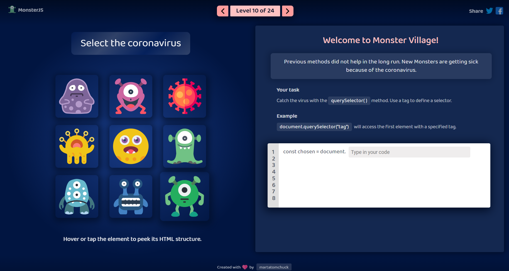

# Welcome to MonsterJS!

#### A game for learning how to access HTML elements using JavaScript DOM selectors.

> **GAME CONCEPT**: A family of friendly little monsters is going through tough times. They have to deal with unwelcome guests, natural disasters, and the spread of coronavirus throughout Monster Village. Only the superpowers of JavaScript can help them overcome these obstacles.

## 🦄 DEMO

**Happy hacking!**

## 🐤 LEARNING OBJECTIVES

The game teaches you how to access DOM elements on an HTML page using predefined JavaScript methods and explains the differences between them:

* getElementById()
* GetElementsByTagName()
* getElementsByClassName()
* getElementsByName()
* querySelector()
* querySelectorAll()

## 📦 PREREQUISITES

**Suitable for all JavaScript learners.**

Basic knowledge of HTML and JavaScript is a plus, but not required.

## 📓 TECHNOLOGIES

* React.js with Hooks
* React Context API
* Yarn package manager
* Webpack
* Babel
* SASS
* CSS animations (eg. shake effect)
* localStorage

**If you spot a bug or have any feedback, please open an issue on GitHub. All feedback is welcome!**

## 👏 CONTRIBUTE

Icons from flaticon.com made by:
* Smashicons: https://www.flaticon.com/packs/monsters-3 + https://www.flaticon.com/packs/alien-ufo-9
* Freepik: https://www.flaticon.com/packs/coronavirus-25 + https://www.flaticon.com/packs/nature-38 + https://www.flaticon.com/packs/fantastic-characters-32 + https://www.flaticon.com/packs/avatars-46
* Dimitry Miroliubov: https://www.flaticon.com/packs/halloween-29
